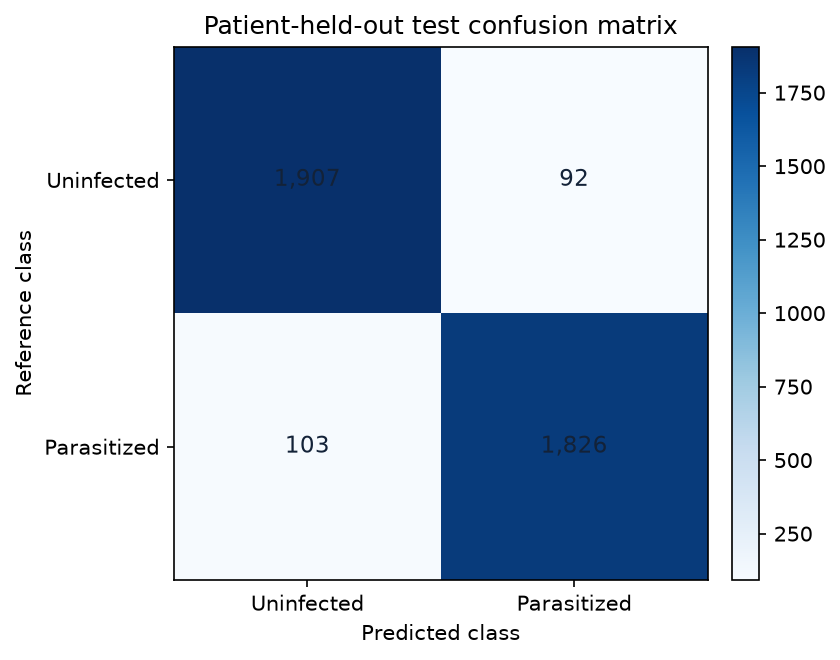
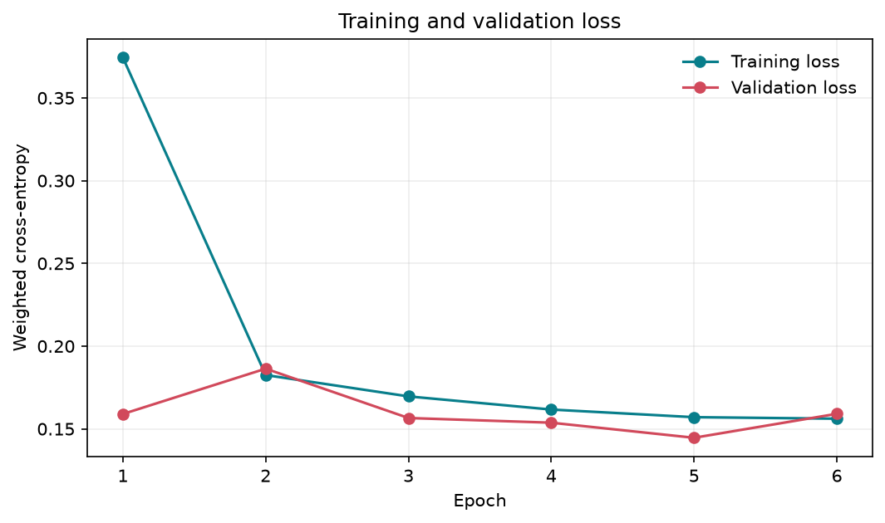

# Experimental results

## Experiment record

- Dataset: NIH/NLM single-cell thin-smear image archive, 27,558 mapped cell images.
- Split seed: 42; patient-grouped approximately 70/15/15 partition.
- Train: 19,112 images from 141 patient groups (9,656 Uninfected; 9,456 Parasitized).
- Validation: 4,518 images from 31 patient groups (2,124 Uninfected; 2,394 Parasitized).
- Test: 3,928 images from **29 patient groups** (1,999 Uninfected; 1,929 Parasitized).
- CNN: custom three-block model, 295,842 trainable parameters; 96×96 RGB inputs.
- Training: CPU, seed 42, AdamW, batch size 64, learning rate 0.001, maximum six epochs. Lowest validation loss selected **epoch 5** (validation loss 0.14462); epoch 6 did not replace it.
- Operating threshold: 0.5, fixed before test evaluation; no threshold was tuned against test data.

## Patient-held-out test metrics

| Metric | Result |
| --- | ---: |
| Accuracy | 95.04% |
| Balanced accuracy | 95.03% |
| Sensitivity (Parasitized recall) | 94.66% |
| Specificity (Uninfected recall) | 95.40% |
| Precision (Parasitized) | 95.20% |
| F1 (Parasitized) | 94.93% |
| ROC-AUC | 0.9856 |
| Matthews correlation coefficient | 0.9007 |
| Weighted test loss | 0.1460 |

### Confusion counts

| Reference class | Predicted Uninfected | Predicted Parasitized |
| --- | ---: | ---: |
| Uninfected | 1,907 | 92 |
| Parasitized | 103 | 1,826 |

**Interpretation:** among the 1,929 held-out parasitized cell crops, the model assigned 103 to the uninfected class at this threshold. The model's high benchmark score does not remove the risk of missed positives and does not establish patient-level diagnostic accuracy.

## Figures and machine-readable output

- 
- 
- Exact metrics: [`artifacts/test_metrics.json`](../artifacts/test_metrics.json)
- Per-cell held-out outputs: [`artifacts/test_predictions.csv`](../artifacts/test_predictions.csv)
- Run settings/split summary: [`artifacts/model_metadata.json`](../artifacts/model_metadata.json)

## Limitations of these results

This is one patient-grouped, internal holdout from a single source collection, not an independent external validation. The test set has a near-balanced cell-label composition and only 29 patient groups; reported cell-level rates are point estimates with no confidence intervals. Multiple images from a patient are correlated, so image count is not an independent-patient count. Softmax scores are not calibrated, and 0.5 is not a clinically selected threshold. Results apply only to the dataset's cropped-cell labels and should not be generalized to whole slides, a person's infection status, other laboratories or treatment decisions.
